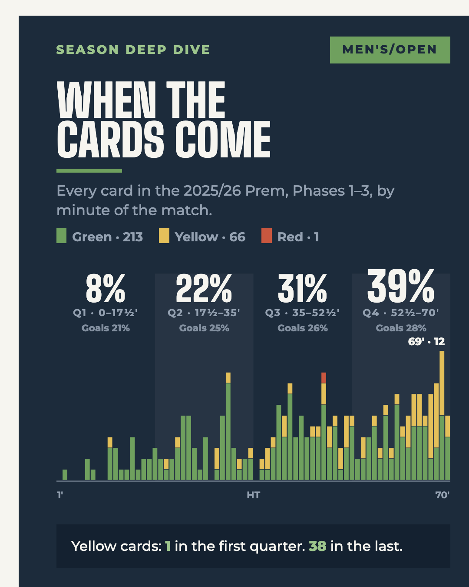
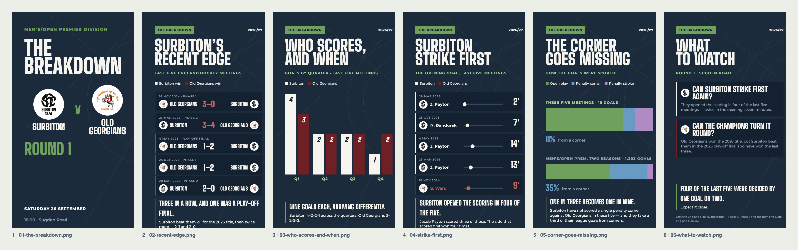
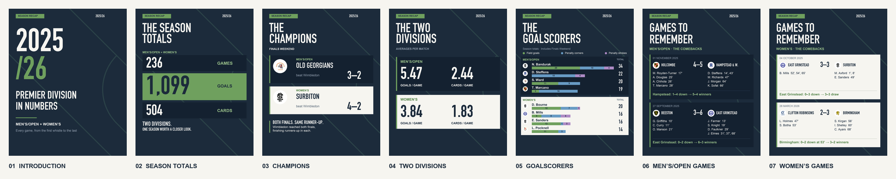

# The Field Hockey Analyst

A complete data platform for English national-league field hockey: ingestion from undocumented
sources, a cleaned relational database, statistical models with honest backtests, an MCP server
that lets AI assistants query the data safely, automated weekly graphics, and a score-prediction
game in progress.

It powers **The Field Hockey Analyst** on Instagram, which publishes data stories about the
England Hockey Premier Division and the national leagues below it. The website is
[thefieldhockeyanalyst.com](https://thefieldhockeyanalyst.com).

> This is a public, curated copy of a private working repo. Code and docs are included; the
> database snapshots are not (see [Data](#data)).

<p>
  
  
  
</p>

## What's in it

```
data/ingest/      Python package: five importers -> one MySQL schema, plus audit / repair tooling
analysis/         models, backtests, simulator, graphics
mcp/              MCP server: the database as tools for AI assistants, with auth and roles
predictor/        the prediction game's backend: Supabase migrations and the weekly publisher
web/              the website (Cloudflare Workers)
weekly.sh         one command: ingest -> models -> checks -> the week's graphics
docs/             the design notes: pipeline bugs, data scope, models, deployment
```

### 1. Data pipeline ([`data/ingest`](data/ingest), [docs/pipeline.md](docs/pipeline.md))

- **Five sources, one schema.** England Hockey's website API (undocumented; historic seasons and
  a separate live-season importer), a scraper for national finals weekend, a parser for
  hand-transcribed pre-2022 results, and a rate-limited, robots.txt-aware scraper for the German
  1. Bundesliga that writes to its own database.
- SQLAlchemy models, Alembic migrations, Pydantic input schemas, idempotent upserts keyed on
  `(source, source_id)`, a Typer CLI, pytest tests against recorded HTML fixtures.
- **Data quality is a feature, not an afterthought.** A 22-check severity-ranked `audit`, plus
  `reconcile`, `backfill-events` and a single idempotent `repair`. Eight silent data bugs found
  and fixed, each documented so it is never reintroduced: duplicate rows from a source-label
  mismatch, whitespace-padded names, 114 fragmented player identities, club renames issuing new
  ids (a human-confirmed alias table), events logged against abandoned fixtures, nickname
  duplicate registrations, postponements recorded as 0-0, and staff cards counted as players'.
- About 6,900 matches and 6,500 players across 14 national leagues, 2019/20 to now.

### 2. Models ([`analysis`](analysis), [docs/modelling.md](docs/modelling.md), [docs/findings.md](docs/findings.md))

- **Poisson attack/defence** score model per gender ([`predictor.py`](analysis/predictor.py)).
- **Power rankings** ([`prem_elo.py`](analysis/prem_elo.py)): Elo restricted to one division,
  margin-of-victory damping, season-boundary regression to the mean, promoted-team seeding, and an
  **ordered-logit layer** that turns a rating gap into win / draw / loss probabilities (Elo alone
  cannot express a draw).
- Tuned on one season, tested once on a held-out season, and compared over four seasons on
  accuracy, log-loss and Brier score, with 95% intervals on the differences
  ([`compare_models.py`](analysis/compare_models.py),
  [report](analysis/reports/model_comparison_2026-11-07.txt)). A 50/50 blend is at least as good
  as either model, so the blend is the published "FHA Model":

  | Premier Division, 2023/24 to now | Matches | Results called right | Log-loss (flat guess: 1.10) |
  |---|---|---|---|
  | Men's/Open | 395 | 73.7% | 0.674 |
  | Women's | 396 | 63.6% | 0.824 |

- **Monte Carlo season simulator** ([`simulate.py`](analysis/simulate.py)): 20,000 runs of the
  remaining fixtures for top-six qualification odds, itself backtested.
- Questions tested against the data rather than assumed: home advantage (none measurable in the
  Premier Division, clear below it), whether club home/away "personalities" are real (noise), the
  cost of a card, squad rotation, competitive balance, when title races are settled.
- A scoring-rule backtest with simulated players to choose the prediction game's points system
  ([`game_scoring.py`](analysis/game_scoring.py)).

### 3. MCP server ([`mcp`](mcp), [docs/mcp.md](docs/mcp.md))

Exposes the database to AI assistants as [Model Context Protocol](https://modelcontextprotocol.io)
tools.

- Three tool tiers: schema tools, a guarded `run_query` (SELECT/WITH only, one statement,
  row cap, 10-second ceiling) and curated tools that build the domain's traps (status codes,
  competition-name drift, gender-ambiguous team names) into the tool so the model can't fall into
  them.
- A SELECT-only MySQL user is the real read-only guarantee, not the code.
- Bearer-token auth with viewer / analyst / admin roles: `tools/list` is filtered per role,
  out-of-role calls are refused, every call is audit-logged.
- stdio and HTTP transports, liveness and readiness endpoints, and a smoke-test client that
  plays the host's part.

### 4. Deployment ([docs/deployment.md](docs/deployment.md))

- The MCP server ran on **AWS**: linux/amd64 images in ECR under immutable `date-sha-slug` tags
  ([`release.sh`](mcp/release.sh)), ECS Fargate behind an Application Load Balancer, ACM TLS,
  credentials from Secrets Manager. Torn down on purpose to stop the running cost; the recipe is
  kept.
- The website runs on **Cloudflare Workers**, deployed from GitHub on every push.
- Next: the weekly update as a scheduled GitHub Actions workflow (MySQL service container,
  restore, ingest, model, publish, commit back), chosen over AWS on cost.

### 5. FHA Weekly Predictor (in progress) ([docs/predictor-game.md](docs/predictor-game.md))

A free game: call the exact score of six Premier Division matches each round. Launching March
2027.

- **Supabase** backend: Postgres with row-level security, anonymous sign-in upgraded by an
  email one-time code. Schema in [`predictor/supabase/migrations`](predictor/supabase/migrations).
- MySQL stays the master; [`publish_round.py`](predictor/publish_round.py) pushes each round's
  fixtures and results one way, and read-only context (form, last meetings) is static JSON.
- [Product spec](docs/predictor-game-spec.md) and an
  [architecture diagram](docs/website-architecture.html).

### 6. Weekly automation ([`weekly.sh`](weekly.sh))

`./weekly.sh call` before a weekend and `./weekly.sh verdict` after it: pull results, retrain both
models, run the integrity checks, freeze or mark the predictions, and render ready-to-post
1080x1350 graphics with matplotlib to a defined brand system.

## Data

The match data belongs to England Hockey and the German Hockeyliga, so this copy does not
include the database snapshots or transcribed results. The code runs against your own ingest:

```bash
cp .env.example .env          # add an England Hockey API key (see docs/data-scope.md)
docker compose up -d db
docker compose run --rm ingest ingest migrate
docker compose run --rm ingest ingest run
```

The docs are working notes and mention a few things kept in the private repo (the content desk,
post drafts), so some links there point nowhere.

## Stack

Python (pandas, NumPy, SciPy, SQLAlchemy, Alembic, Pydantic, httpx, Typer, matplotlib, pytest) ·
MySQL, Postgres, SQLite · Docker Compose · Jupyter · MCP · AWS (ECR, ECS Fargate, ALB, ACM,
Secrets Manager) · Cloudflare Workers · Supabase · built with Claude Code
